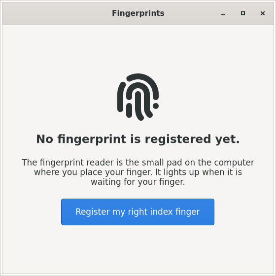

# Fingerprints (`fingerprint-settings`)

[](https://github.com/validity-rs/fingerprint-settings/actions/workflows/ci.yml)
[](https://github.com/validity-rs/fingerprint-settings/releases/latest)
[](LICENSE)

Fingerprints is a small desktop app that does one thing: register your right
index finger, or remove it, so that touching the reader unlocks the computer.
It is meant for desktops without fingerprint settings of their own, such as
Xfce, MATE and LXQt, and for people who have never used a fingerprint reader.

It works with any service that speaks fprintd's D-Bus API: fprintd itself, or
[validity-rs](https://github.com/validity-rs/validity-rs)'s daemon for the
Synaptics `06cb:009a` sensors of ThinkPad T480-class laptops.

## Contents

- [What it looks like](#what-it-looks-like)
- [Install](#install)
- [Requirements](#requirements)
- [Use](#use)
- [Try it without a reader](#try-it-without-a-reader)
- [Accessibility](#accessibility)
- [For developers](#for-developers)
- [License](#license)

## What it looks like

One screen, in English or French (it follows the desktop's language). In
French the app is called « Empreintes digitales ».

| English | French |
|---|---|
|  |  |

The screenshots show the app against validity-rs's emulated reader (see
[Try it without a reader](#try-it-without-a-reader)).

- A status line: "Your right index finger is registered." or "No fingerprint
  is registered yet."
- Before registering, where the reader is and that it lights up when it is
  waiting (the reader's place depends on the laptop, so it is not named).
- One big button, **Register my right index finger**. While you touch the
  reader, a single progress bar fills with each good scan, with one short
  instruction and one gentle hint ("Place your right index finger on the
  reader.", then "Lift your finger, then place it again."). There is no scan
  count, and a scan that did not take is not an error: the bar waits for the
  next one.
- **Remove the fingerprint**, shown only when the finger is registered.

Every result and error is one plain sentence that says what to do next (a
finger already registered, perhaps on another account; permission refused;
no reader found), and the screen stays usable after any of them. The password
always keeps working.

## Install

| Distribution | Package |
|---|---|
| Debian 13 (trixie) | `fingerprint-settings` in the validity-rs APT repository |
| Ubuntu 26.04 (resolute) | in the APT repository |
| Fedora 44, Arch Linux, Alpine 3.24 | files on the [latest release](https://github.com/validity-rs/fingerprint-settings/releases/latest) |
| Ubuntu 24.04 (noble) | not available: its GTK 4.14 and libadwaita 1.5 are too old |

On Debian 13, set up the [validity-rs APT repository](https://validity-rs.github.io/apt/)
(the steps are in the [validity-rs README](https://github.com/validity-rs/validity-rs#install)),
then:

```bash
sudo apt install fingerprint-settings
```

From the release files (check them first, see [Release](#release)):

```bash
sudo dnf install ./fingerprint-settings-0.1.1-1.fc44.x86_64.rpm                 # Fedora 44
sudo pacman -U fingerprint-settings-0.1.1-1-x86_64.pkg.tar.zst                  # Arch Linux
sudo apk add --allow-untrusted fingerprint-settings-0.1.1-r0.apk                # Alpine 3.24
```

The Alpine package is signed with a key made for each CI build, which is not
published; hence `--allow-untrusted`.

Each package depends on a fingerprint service: `fprintd | validity-daemon`
on Debian and Ubuntu, `(fprintd or validity-daemon)` on Fedora, `fprintd` on
Arch Linux and Alpine (where validity-daemon depends on fprintd and takes over
its service).

## Requirements

- A fingerprint service on the system bus (`net.reactivated.Fprint`):
  fprintd, or validity-daemon. The app uses only the standard API:
  `Manager.GetDefaultDevice`, `Device.ListEnrolledFingers`, `Claim`,
  `Release`, `EnrollStart("right-index-finger")`, `EnrollStop`, and
  `DeleteEnrolledFinger("right-index-finger")`, falling back to
  `DeleteEnrolledFingers2` on older services (which removes all of the user's
  fingerprints).
- GTK 4.18 and libadwaita 1.7 or newer (Debian 13 is the oldest supported
  system).
- A polkit authentication agent in the session. Whether you may change your
  fingerprints is the service's polkit policy
  (`net.reactivated.fprint.device.enroll`); fprintd's default asks for your
  own password. Xfce: `xfce-polkit` or `policykit-1-gnome`; MATE:
  `mate-polkit`; LXQt: `lxqt-policykit`. Without an agent the app says that
  permission was refused.

## Use

Open **Fingerprints** from the Settings menu (on Xfce, also in the Settings
Manager under Hardware), or run `fingerprint-settings`. Press the button,
then touch the reader each time it lights up, lifting your finger in between
and moving it a little each time, until the bar is full.

A call that may show the password prompt is given ten minutes; any other
call one minute, after which the app says the service did not answer.
Closing the window during a registration or a removal stops it and releases
the reader first.

To log in with the finger, see the
[validity-rs README](https://github.com/validity-rs/validity-rs#log-in-with-a-finger)
or your distribution's fprintd documentation.

## Try it without a reader

`e2e/examples/demo_service.rs` runs validity-rs's daemon with its emulated
sensor on a private bus; the app finds it through `DBUS_SYSTEM_BUS_ADDRESS`:

```bash
dbus-daemon --session --nofork --print-address=1 > /tmp/demo-bus &
sleep 1; BUS=$(head -1 /tmp/demo-bus)
cargo run --manifest-path e2e/Cargo.toml --example demo_service -- --address "$BUS" &
DBUS_SYSTEM_BUS_ADDRESS="$BUS" cargo run
# While the app waits for a finger, "touch" the emulated reader
# (finger number 1; another number is another finger):
gdbus call --address "$BUS" --dest io.github.validity_rs.FingerprintSettings.Demo \
    --object-path /io/github/validity_rs/FingerprintSettings/Demo \
    --method io.github.validity_rs.FingerprintSettings.Demo.Touch 1
```

## Accessibility

- Large text: the window's text is 15% larger than the desktop's, the
  instruction during registration larger still, and the buttons are big.
- Keyboard: every action is reachable with Tab and Enter; the button that can
  be used has the focus; Escape cancels a registration.
- Screen readers: every control has a text label; instructions and messages
  are announced when they change.
- Nothing is told by colour alone: the status and every result are words.

## For developers

App id: `io.github.validity_rs.FingerprintSettings`.

### Build and run

Rust 1.99 or newer, and the GTK 4 and libadwaita development packages
(Debian/Ubuntu: `libgtk-4-dev libadwaita-1-dev`; Fedora: `gtk4-devel
libadwaita-devel`; Arch: `gtk4 libadwaita`; Alpine: `gtk4.0-dev
libadwaita-dev`).

```bash
cargo build --release
./target/release/fingerprint-settings
```

To install from source for all users:

```bash
sudo install -Dm755 target/release/fingerprint-settings /usr/local/bin/fingerprint-settings
sudo install -Dm644 packaging/common/io.github.validity_rs.FingerprintSettings.desktop \
    /usr/local/share/applications/io.github.validity_rs.FingerprintSettings.desktop
sudo install -Dm644 packaging/common/io.github.validity_rs.FingerprintSettings.metainfo.xml \
    /usr/local/share/metainfo/io.github.validity_rs.FingerprintSettings.metainfo.xml
sudo install -Dm644 packaging/common/icons/hicolor/scalable/apps/io.github.validity_rs.FingerprintSettings.svg \
    /usr/local/share/icons/hicolor/scalable/apps/io.github.validity_rs.FingerprintSettings.svg
sudo install -Dm644 packaging/common/fingerprint-settings.1 /usr/local/share/man/man1/fingerprint-settings.1
```

### Architecture

- `src/machine.rs`: the state machine. User actions and service replies and
  signals go in as `Input`s; the view state (`Model`) and the service calls
  to make (`Command`s) come out. No GTK, no D-Bus.
- `src/fprint.rs`: runs the commands over D-Bus on a thread of its own and
  turns replies and signals into inputs, in bus order.
- `src/status.rs`, `src/error.rs`: what to tell the user for each fprintd
  result and each error.
- `src/ui.rs`, `src/main.rs`: the GTK 4 / libadwaita window, one screen,
  which only renders the model and forwards clicks.

### Tests

```bash
cargo test                                   # the app
cargo test --manifest-path e2e/Cargo.toml    # the end-to-end test (needs dbus-daemon and network)
```

- Unit tests of the UI-free core (`src/machine.rs` and its tests, `status`,
  `error`, `i18n`): every enrolment result and service error mapped to its
  exact sentence, the progress bar moving forward on good scans only,
  cancelling at each step, a claimed reader always released, the fallback to
  `DeleteEnrolledFingers2`, the screen staying usable after any failure.
- `tests/translations.rs`: every user-visible string has a French
  translation, nothing in the catalogue is stale, placeholders and French
  typography are right; the desktop entry and metainfo are translated.
- `tests/packaging.rs`: the version in `Cargo.toml` is the metainfo's latest
  release, the Debian changelog's and the Fedora spec's.
- `e2e/tests/end_to_end.rs`: the same core and D-Bus driver as the window,
  against validity-rs's daemon with its emulated sensor on a private
  `dbus-daemon`: register and remove the right index finger, a finger
  registered by another tool, a duplicate, a cancel, a busy reader, polkit
  refusals, no service, no reader, the service going away, an older service
  without `DeleteEnrolledFinger`, and a service that never answers.

`e2e/` is a package of its own (its own workspace and `Cargo.lock`), so that
building, testing and packaging the app never needs validity-rs. It depends
on validity-rs's daemon by git URL, pinned by commit (cargo fetches it from
GitHub). To move to another commit, change `rev` in `e2e/Cargo.toml` and run
`cargo update -p validity-daemon --manifest-path e2e/Cargo.toml`. To try a
local validity-rs checkout without touching tracked files, add
`--config 'patch."https://github.com/validity-rs/validity-rs.git".validity-daemon.path="../validity-rs/crates/validity-daemon"'`
to the cargo command (without `--locked`, and do not commit the
`e2e/Cargo.lock` it rewrites).

### CI

`ci/run.sh` is the whole CI, runnable locally; GitHub Actions
(`.github/workflows/ci.yml`) calls the same jobs.

```bash
ci/run.sh                    # quick: noai zizmor gitleaks fmt clippy doc test packaging e2e
ci/run.sh all                # quick + every distro and every package
ci/run.sh distro:fedora      # the tests on one distro
ci/run.sh package:alpine     # one package's full cycle
```

- `noai zizmor gitleaks` run on the host;
- `fmt clippy doc test packaging e2e` run in the pinned Debian 13 image
  (`docker/Dockerfile.debian`) when docker is available, or on the host with
  `CI_HOST=1`;
- `distro:<distro>`: `cargo test` on Debian 13, Ubuntu 26.04, Fedora, Arch
  Linux and Alpine 3.24, each with its own GTK 4 and libadwaita;
- `package:<distro>`: the package cycle below;
- `tarball`, `release-files`, `publish`: used by the release workflow.

Every image is pinned by digest (`docker/Dockerfile.<distro>`, with `ci`,
`package` and `install` stages), every action by commit, every downloaded
tool by version and SHA-256. CI keeps each commit's packages as artifacts for
two weeks.

### Packages

Each package is built from the vendored source tarball in a pinned container
of its distro, checked with the distro's own tool, then installed, launched
headless and removed in a fresh container (`ci/run.sh package:<distro>`;
files in `dist/<distro>/`):

| Distro | Recipe | Built with | Checked with |
|---|---|---|---|
| Debian 13 | `[package.metadata.deb]` in `Cargo.toml`, `packaging/debian/` | cargo-deb 3.8.0 | lintian (errors, warnings and info fail; the two overrides are explained in `packaging/debian/lintian-overrides`) |
| Ubuntu 26.04 | the Debian recipe, built in Ubuntu 26.04 (`docker/Dockerfile.ubuntu-resolute`), Debian revision `1.ubuntu26.04` | cargo-deb 3.8.0 | Ubuntu's lintian, as for Debian |
| Fedora 44 | `packaging/fedora/fingerprint-settings.spec` | rpmbuild, Fedora's Rust macros | rpmlint `--strict` |
| Arch Linux | `packaging/archlinux/PKGBUILD.in` | makepkg | namcap (only the findings listed, with reasons, in `packaging/archlinux/namcap-expected`) |
| Alpine 3.24 | `packaging/alpine/APKBUILD.in` | abuild | apkbuild-lint |

Every package ships the binary, the desktop entry, the AppStream metainfo,
the icon, the manual page, the README and the license; the translations are
compiled into the binary. In every distro, `desktop-file-validate` and
`appstreamcli validate` check the installed files, and so does the package
manager's own check (`dpkg --verify`, `rpm -V`, `pacman -Qkk`, `apk audit`).
The headless launch (`ci/packages/smoke.sh`) starts the installed binary
under Xvfb against a stub service (`examples/stub_service.rs`) on a private
bus, and passes once the app has asked for the fingerprints, its window is
mapped, and it runs with no panic or critical message.

Notes:

- The PKGBUILD and APKBUILD are templates: the build writes the version and
  the tarball's checksum into them. The release attaches the written ones,
  for the AUR and aports.
- Alpine 3.24's Rust (1.96) is older than the crate's `rust-version` (1.99):
  the Alpine package is built with the official `rust:1.99.1-alpine3.24`
  toolchain, linked dynamically (`-C target-feature=-crt-static`) like
  Alpine's own Rust.
- The .deb files go to validity-rs's APT repository, one suite per release,
  with the suffixes of validity-rs's `ci/packages/suites.sh`: the Debian
  build to `trixie`, the `.ubuntu26.04` build to `resolute`. The repository
  is rebuilt by each validity-rs release, with the latest release of this
  app.

### Release

`.github/workflows/release.yml`, on a version tag (`v0.1.0`, which must be
the version in `Cargo.toml`):

1. runs the whole CI on the tagged commit, and goes on only if it is green;
2. builds the vendored source tarball twice and checks both are the same
   bytes (`ci/packages/tarball.sh`: the tracked files plus `vendor/` and
   `.cargo/config.toml`, so the packages build offline; timestamps from
   `SOURCE_DATE_EPOCH`);
3. builds every package from it twice and checks the builds are the same
   bytes (the `.apk` by its `.PKGINFO`, since its signature uses a key made
   for each build), then runs the package cycle;
4. writes `SHA256SUMS` and a build provenance attestation (Sigstore-signed,
   SLSA) for every file;
5. creates a **draft** GitHub release with the tarball, the packages, the
   written PKGBUILD, `.SRCINFO` and APKBUILD, and `SHA256SUMS`;
6. publishes to crates.io through Trusted Publishing only once `Cargo.toml`
   allows it; today it says `publish = false`.

Check a downloaded file:

```bash
sha256sum -c SHA256SUMS --ignore-missing
gh attestation verify FILE --repo validity-rs/fingerprint-settings
```

Run by hand (`workflow_dispatch`), the workflow is a dry run: everything is
built and checked, nothing is attested, released or published.

### Translations

Strings are written in English in the source, through `tr("…")`,
`trf("…", …)`, `msg("…")` or `n_("…")`, always with a string literal. The
catalogues are gettext PO files in `po/`, compiled into the binary (no
`msgfmt` needed). The language follows `LANGUAGE`, `LC_ALL`, `LC_MESSAGES`
and `LANG`, like gettext.

To add a language, for example German:

1. Copy `po/fr.po` to `po/de.po`, set `Language: de` in its header, and
   translate every `msgstr`, keeping the `{placeholders}`.
2. Add `("de", include_str!("../po/de.po"))` to `CATALOGUES` in
   `src/i18n.rs`.
3. Add `Name[de]`, `GenericName[de]`, `Comment[de]` and `Keywords[de]` to the
   desktop entry, and `xml:lang="de"` elements to the metainfo.
4. Run `cargo test --test translations`: it lists anything missing.

### Contributing

Issues and pull requests are welcome. Code must pass `ci/run.sh`; every
user-visible string needs its French translation; the app uses only the
standard fprintd API.

## License

MIT, see [LICENSE](LICENSE).
